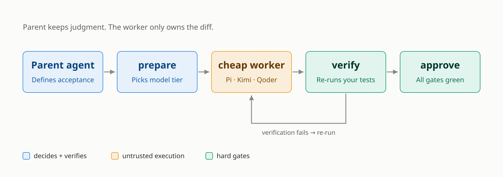

# spotworkers

[](https://www.npmjs.com/package/spotworkers)
[](https://www.npmjs.com/package/spotworkers)
[](./LICENSE)
[](https://github.com/hLxiao9/spotworkers/actions/workflows/ci.yml)

> **Stop spending your Claude Code / Codex quota on work a cheap model can do.**
>
> `spot` hands a bounded implementation task to a cheap agent worker (Pi / Qwen / DeepSeek / Kimi / Qoder / CodeBuddy), then independently re-runs your tests, checks the diff hash, and merges only when every gate is green. Architecture, review and commit authority stay with your main agent.

[English](./README.md) | [简体中文](./README.zh-CN.md)

The main agent never asks the user to defend code it did not write. **Treat the worker as untrusted**: it never gets Bash, extensions, Skills, or project trust, and it cannot lie about test results — the wrapper writes `verification.json`, not the worker.

> Renamed from `pi-delegate`. The `pi-worker` command still works as an alias for `spot`.

---

<picture>
  <source media="(prefers-color-scheme: dark)" srcset="docs/delegation-loop-dark.svg">
  
</picture>

## Features

### Closed-loop delegation with independent verification
`doctor → prepare → run → verify → self-review → approve → integrate → report → cleanup`. The wrapper re-runs your verification commands itself (not Pi's claims) and the diff hash is checked at every gate — a changed hash blocks approval.

### Anti-cheat self-review (parent token saver)
Before the parent agent reads the full diff, an optional second Pi turn re-reads its own work and emits a compact `self-review.json` (~50 lines vs thousands). Five anti-cheat safeguards keep it honest:
- `verification.json` is produced by the wrapper, not Pi — Pi cannot lie about test results.
- `diffSha256Mismatch=true` if Pi echoes the wrong hash → parent falls back to full review.
- `fallbackRecommended=true` when Pi self-reports `unmet`/`uncertain` or any P0–P2 finding → parent falls back.
- `approve` re-scans the diff and rejects if the hash changed.
- High-risk tasks never reach self-review (`HIGH_RISK_BLOCKED`).

Self-review never blocks the loop — on Pi failure, parse failure, or diff below `minDiffBytes`, it self-degrades to `reviewing` with `skipped:true`. Disable with `selfReview.enabled=false`.

### Hard gates & security
- Wrapper verification success, unchanged diff hash, passed security scan, acceptance evidence, and **zero unresolved P0–P2 findings** required to approve.
- Pi is treated as untrusted: Bash, extensions, Skills, prompt templates, context files, and project auto-trust are never enabled.
- Never pushes, creates PRs, changes remotes, or describes worktree isolation as an OS sandbox.
- Never routes around authentication errors or capability mismatches with a fallback — a setup/credential failure is a real blocker.

### Crash-safe recovery
Process-group timeouts, SIGINT/SIGTERM cleanup, and stale-lock reclamation. After an interruption, `spot recover --id <run-id>` reopens the run in place: a partial diff goes to `verify`, an empty diff goes back to `run`. A live lock is never stolen — only a lock whose owner process is gone is reclaimed.

### Multi-parent dispatch
Tracks the caller (`trae`, `codex`, `claude-code`, `cursor`, `pi-recursive`, `cli`) via the `PARENT_AGENT` / `PI_WORKER_CALLER` env var, so the dashboard can attribute runs and `list --caller <name>` can filter.

### Parallel execution
Multiple parent-agent sessions can run concurrently — each run gets an isolated Git worktree, state directory, and per-run file lock, so different runs never collide and the same run is never advanced by two processes at once. `maxConcurrentRuns` (default 4, range 1–16) caps active runs; `prepare` rejects with `CONCURRENCY_LIMIT` when the cap is hit. The dashboard reads `state.json` with JSON-parse tolerance, so a snapshot never crashes on a concurrent write.

### Automatic model selection by difficulty
Task signals (goal length, acceptance-criteria count, risk, constraints, required capabilities, verification count, path breadth) map to `low`/`medium`/`high` difficulty, which selects a `cheap`/`standard`/`premium` profile. Within a tier, `task.domain` (or an inferred domain) soft-matches `profile.strengths`. Override with `--profile <name>`; disable auto-selection by leaving `costTier` off your profiles.

### Multi-CLI backends
Beyond the default Pi backend, profiles can set `adapter: kimi | trae | qoder | opencode | codebuddy` to drive other coding CLIs (Kimi Code CLI, Trae CLI, Qoder CLI, OpenCode, CodeBuddy Code CLI). Cross-adapter fallback works seamlessly. See [`references/provider-configuration.md`](./references/provider-configuration.md).

### Cost & savings metrics
Every run records token usage (input/output/cached), displaced parent-side credits, equivalent parent credits, saving rate, and subscription-allowance portion. All adapters report tokens through a unified `message_end` event, so the dashboard's Token and duration columns are real per-connector numbers. Where a backend bills in credits instead of dollars (Qoder CN reports `total_credits`, not token counts), that figure is surfaced as its own field and the dollar-equivalent saving rate degrades to `null` rather than being invented.

### Live monitoring dashboard
HTTP server with refresh button, summary cards, filterable run table (by caller, status, free text), expandable detail rows, light/dark theme, and a "Connection status" tab showing CLI adapter and profile credential health.

## Recent updates

`v0.1.0` shipped the core loop. Since then (unreleased, on `main`):

- **Free-tier routing.** `model: "free"` (aliases `qoder-free`, `cheapest`) resolves at dispatch time to the lowest `price_factor` model the account can actually reach, so a profile never hardcodes a model name that gets delisted. Qoder currently exposes two at `0x`: `DeepSeek-Flash` and `Qwen3.8-Flash`.
- **Price-aware catalog.** `spot detect` prints each model with its multiplier, context tiers and legal effort levels — `12 model(s) (2 free)` followed by per-model `[free]` / `[0.1x]` / `[1.4x]`. The catalog is cached for 30 minutes and degrades to "no catalog" when offline instead of failing the run.
- **Per-model capability validation.** An unsupported `reasoningEffort` or `maxContextSize` is snapped to the nearest legal value for the pinned model and recorded as a `worker_warning` event plus a `[warn]` line in `worker.log`. Adjustments are visible, never silent.
- **CodeBuddy CLI adapter.** Sixth backend, alongside Pi, Kimi, Trae, Qoder and OpenCode (`adapter: codebuddy`).
- **Usage metering for every adapter.** Non-streaming backends echo a `message_end` usage event, so `readPiUsage` aggregates tokens and duration uniformly. Dashboard labels are adapter-agnostic ("Token", "duration", "call count").
- **Fixed: `EXCESSIVE_DELETION` rejected every pure edit.** The guardrail measured `deleted / (added + deleted)`, so a one-line fix always scored `0.5` and was blocked — the single most common delegation shape. It now measures against base-file size, with `limits.maxDeletedLines` (default `300`) as an absolute ceiling.
- **Fixed: Qoder ran interactively and hung.** The CN build now gets `-p/--print` explicitly; without it the worker opened a TUI and stalled until the runner timeout. Auth failures are also classified as `auth` instead of `permanent`, so a bad token reads as a setup problem rather than bad code.
- **Dashboard.** 60s auto-refresh (persisted in localStorage, refreshes on tab focus), `workbuddy` recognised as a caller, and a `worker.log` + `scripts/pi-tmux-monitor` for watching concurrent runs.

## Prerequisites

- **Node.js** `>=22.19.0`
- **At least one worker CLI** on `PATH` — Pi (the default), or Kimi / Trae / Qoder / OpenCode / CodeBuddy with the matching `adapter` in your profile. `PI_WORKER_PI_BIN` only applies to the Pi adapter; the others never shell out to `pi`.
- **Git** (the worker requires a Git repository)
- Provider credentials in env (e.g. `VOLCENGINE_API_KEY`)

Run `spot detect` to see which worker CLIs this machine already has.

## Install a worker CLI

The default backend is the [Pi CLI](https://github.com/earendil-works/pi) (project page: <https://pi.dev/>). Pi is a separate open-source project — install it independently. If you prefer another backend, skip to [`adapter`](#multi-cli-backends) and install that CLI instead; only the adapter you select has to exist on `PATH`.

**Option A — npm global (cross-platform)**

```bash
npm install -g --ignore-scripts @earendil-works/pi-coding-agent
pi --version          # verify; spotworkers requires >= 0.80.10
```

**Option B — one-line installer (macOS / Linux)**

```bash
curl -fsSL https://pi.dev/install.sh | sh
pi --version
```

**First-time Pi setup**: launch `pi` once in any directory, then run `/login` inside Pi to configure a model provider (API key or subscription login). See the [Pi documentation](https://pi.dev/) for the full provider list (Anthropic, OpenAI, Google, Volcengine, DeepSeek, Kimi, MiniMax, GLM, Qwen, OpenRouter, Ollama, …).

> spotworkers only invokes Pi non-interactively (`pi -p`), so the interactive TUI is just for initial `/login` and model setup. You never need to drive Pi by hand for delegated tasks.

## Install

### Option 1 — npm global (recommended)

```bash
npm install -g spotworkers
spot --help
```

### Option 2 — npx (no install)

```bash
npx -p spotworkers spot serve
```

The package ships two binaries (`spot` and the `pi-worker` alias), so npx has to be told which one to run — a bare `npx spotworkers` cannot guess.

### Option 3 — as a Pi package

```bash
pi install npm:spotworkers
```

This registers the bundled `SKILL.md` with Pi, so `/skill:spotworkers` becomes available inside a Pi session. It does not put `spot` on your `PATH` — use Option 1 if you want both.

### Option 4 — local link (for development / pre-publish verification)

```bash
git clone https://github.com/hLxiao9/spotworkers.git
cd spotworkers
npm install        # only if you add deps later; currently zero runtime deps
npm link           # exposes `spot` on PATH
spot --help
```

> **Roadmap**: Homebrew tap (`brew tap hLxiao9/spotworkers && brew install spotworkers`) and a `curl | sh` one-line installer will be added after the first npm release.

## First-time setup

`npm install -g spotworkers` automatically runs `node scripts/install-config.mjs` (via the `postinstall` hook) to merge the default config into `~/.config/pi-worker/config.json` and the Volcengine provider into `~/.pi/agent/models.json`. The merge is idempotent — your existing profiles, rate card, and subscription are preserved.

If the auto-config did not run (e.g., `npm install --ignore-scripts`, a sandboxed package manager, or a tarball install), run it manually:

```bash
node scripts/install-config.mjs   # merges defaults; never overwrites user edits
spot init                    # interactive provider selection + credential report
```

> **`apiKeyEnv` contract warning**: the `apiKeyEnv` field in `~/.config/pi-worker/config.json` and the `$VAR` reference in `~/.pi/agent/models.json` must point to the **same** environment variable name. Mismatched names (e.g., `apiKeyEnv: VOLCENGINE_API_KEY` in config but `$API_KEY` in models.json) cause silent 401s at run time. `spot doctor` detects this and suggests the correct name.

## Quickstart

```bash
# 1. Pre-flight check (validates Pi, model, credentials, config — no run created)
spot doctor --task ./task.json

# 2. Prepare an isolated worker branch + worktree
spot prepare --task ./task.json --usage-start ./usage-start.json

# 3. Run Pi on the isolated worktree
spot run --id <run-id>

# 4. Verify the actual diff (independent of Pi's claims)
spot verify --id <run-id>

# 5. Approve + integrate into the source branch
spot approve --id <run-id> --review ./review.json --message "feat: ..."
spot integrate --id <run-id>

# 6. Persist metrics + clean up
spot report --id <run-id>
spot cleanup --id <run-id>
```

If the terminal or parent process is interrupted, inspect the persisted run and
re-enter the same closed loop instead of creating a new run:

```bash
spot inspect --id <run-id>
spot recover --id <run-id>
```

`recover` only reopens an interrupted or timed-out run. If the worker left a
partial diff, it sends the run to `verify`; if no diff exists, it sends it back
to `run`. A live lock is never stolen; only a lock whose owner process is gone
is reclaimed.

See [`SKILL.md`](./SKILL.md) for the full parent-agent workflow, hard gates, and routing rules.

## Integrating with parent agents

spotworkers is a **skill**: it is driven by your parent agent (Codex / Claude Code / Trae / Cursor / another Pi) reading [`SKILL.md`](./SKILL.md) and then invoking the `spot` CLI. The parent keeps architecture, review, and commit authority; Pi only implements the bounded task.

### Step 1 — Give the parent agent the skill

Load `SKILL.md` into the parent agent's context using whichever mechanism that agent supports:

| Parent agent | How to load `SKILL.md` |
|---|---|
| **Pi** | `pi install path/to/spotworkers` (treats it as a local Pi skill package) |
| **Codex (OpenAI)** | Drop `SKILL.md` (or a symlink) into `~/.codex/skills/` and restart Codex, or paste its contents into your project's `AGENTS.md` |
| **Claude Code** | Add the skill under `~/.claude/skills/` or include the contents in `.claude/CLAUDE.md` |
| **Trae** | Add the contents of `SKILL.md` to your Trae project rules / instructions |
| **Cursor** | Add the contents of `SKILL.md` to `.cursor/rules/` (project rules) |
| **Ad-hoc shell** | Just `node scripts/spot.mjs <command> ...` — no skill loading needed |

`SKILL.md` is self-contained: it tells the parent agent the closed-loop workflow (`doctor → prepare → run → verify → self-review → approve → integrate → report → cleanup`), the hard gates, the routing rules, and the exact `spot` commands. The parent agent then calls `spot` via its normal shell/bash tool.

### Step 2 — Identify the caller

Set `PARENT_AGENT` (or `PI_WORKER_CALLER`) in the environment that invokes `spot prepare`, so usage tracking and the dashboard can attribute runs correctly:

```bash
export PARENT_AGENT=codex      # one of: codex | claude-code | trae | cursor | pi-recursive | cli
```

### Step 3 — Run a delegated task

Once the skill is loaded, ask your parent agent in natural language, e.g.:

> "Delegate to Pi: add a `slugify` function to `utils.js` that lowercases, trims, collapses whitespace to hyphens, and strips non-alphanumerics. Tests in `test.js` must pass."

The parent agent will construct a `task.json` matching [`schemas/task-contract.schema.json`](./schemas/task-contract.schema.json), then drive the full closed loop itself. You do not need to call `spot` manually.

### Step 4 — Watch the dashboard

While the parent agent works, open a second terminal:

```bash
spot serve    # http://localhost:7317/
```

The dashboard groups runs by caller, so you can see which agent is delegating what, in real time.

> **Note on `trae` and `cursor` callers**: usage metering for these two is not yet implemented — the dashboard reports `available: false` for their usage numbers. Set `PARENT_AGENT=codex` or `claude-code` instead if you need usage stats.

## Monitoring

Every run is persisted under `~/.local/state/pi-worker/runs/<run-id>/` (`state.json`, `pi-events.jsonl`, `metrics.json`, `report.md`). Query it without touching the worker:

| Command | Purpose |
|---|---|
| `spot list [--status <s>] [--caller <c>]` | JSON array of runs |
| `spot inspect --id <run-id>` | Full state + metrics + verification + review + Pi usage |
| `spot recover --id <run-id>` | Reopen an interrupted/timed-out run safely |
| `spot dashboard [--output <file>]` | Static single-page HTML snapshot |
| `spot serve [--port <port>] [--no-open]` | **Live** HTTP dashboard with refresh button |

### Live dashboard

**Fastest: double-click launcher**

The [`start-dashboard.command`](./start-dashboard.command) at the repo root is a one-click launcher (double-click on macOS):

- Auto-detects the `spot` command; prints `npm install -g spotworkers` or `npm link` hints when missing
- Starts a local HTTP server and opens the browser automatically
- The "Refresh" button in the browser pulls the latest usage in real time, or just press F5
- `Ctrl+C` stops the server
- Port can be overridden with the `PI_WORKER_PORT` env var (default 7317)

Linux / generic environments:

```bash
bash start-dashboard.command
# or directly
spot serve
```

**Direct CLI invocation**:

```bash
spot serve              # http://localhost:7317/
spot serve --port 8080  # custom port
spot serve --no-open    # do not auto-open browser
```

- `GET /` — HTML dashboard
- `GET /api/fragment` — rendered HTML fragment (used by the "Refresh" button)
- `GET /api/runs` — raw JSON of state + metrics
- `GET /health` — health check

The "Refresh" button (and ordinary F5) re-reads `~/.local/state/pi-worker/runs/` so you always see the latest runs. A statically opened `dashboard.html` (`file://`) is a snapshot — use `serve` for real-time monitoring.

### Caller identification

Set `PARENT_AGENT` (or `PI_WORKER_CALLER`) in the environment that invokes `spot prepare`:

```bash
PARENT_AGENT=codex   spot prepare --task ./task.json   # → caller: codex
PARENT_AGENT=trae    spot prepare --task ./task.json   # → caller: trae
PARENT_AGENT=cli     spot prepare --task ./task.json   # → caller: cli
```

The dashboard groups runs by caller; `list --caller <name>` filters accordingly.

## Configuration

### File locations

- Default config: `fixtures/default-config.json`
- User config: `~/.config/pi-worker/config.json`
- Models registry: `~/.config/pi-worker/models.json`
- Override paths via env: `PI_WORKER_CONFIG`, `PI_WORKER_MODELS_FILE`, `PI_WORKER_STATE_DIR`, `PI_WORKER_CACHE_DIR`, `PI_WORKER_PI_BIN`

### Configuring models

spotworkers does **not** manage model credentials itself — Pi does. The flow is:

1. **Configure providers in Pi first.** Launch `pi`, run `/login`, and add your API keys / subscriptions. Pi stores them in `~/.pi/agent/models.json`. See the [Pi documentation](https://pi.dev/) for the full provider list and setup steps.
2. **List models Pi can see**, to confirm what you can reference in spotworkers profiles:

   ```bash
   pi --no-extensions --no-skills --no-prompt-templates --no-themes --no-context-files --no-approve --list-models
   ```
3. **Map those models to spotworkers profiles** in `~/.config/pi-worker/config.json`. Each profile picks a `provider` + `model` from Pi's registry and tags it with a `costTier` (`cheap` / `standard` / `premium`), `strengths` (domains), and `modalities`. Nine profiles ship by default (`volcengine`, `deepseek`, `kimi`, `minimax-m3`, `gemini-vision`, `gpt-image`, `kimi-cli`, `trae-cli`, `qoder-cli`) — see [`references/provider-configuration.md`](./references/provider-configuration.md) for the full table and copy-paste JSON snippets for adding your own.
4. **Validate** with `spot doctor` — it checks Node, Git, Pi, credentials, model availability, and task schema in one pass.

> **Tip**: spotworkers auto-selects a profile by task difficulty (`low → cheap`, `medium → standard`, `high → premium`). To force a specific profile (e.g. you only have MiniMax credentials), pass `--profile minimax-m3` to `doctor` / `prepare`.

### Multi-CLI backends (Pi / Kimi / Trae / Qoder)

Beyond the default Pi backend, profiles can set `adapter: kimi | trae | qoder` to drive other coding CLIs. See the "Multi-CLI Adapter Support" section in [`references/provider-configuration.md`](./references/provider-configuration.md).

## Development

```bash
npm test              # node:test suite
npm run check:syntax  # node --check on all entry points
npm run check         # syntax + tests
```

Tests live in `tests/*.test.mjs` and run with `node --test --test-concurrency=1`.

## Project layout

```
spotworkers/
├── scripts/
│   ├── spot.mjs        # CLI entry (bin)
│   ├── install-config.mjs   # one-time config bootstrap
│   └── parent-meter.mjs     # parent-agent usage snapshot
├── lib/
│   ├── cli.mjs              # arg parsing + dispatch
│   ├── dashboard.mjs        # HTML rendering + summary logic
│   ├── server.mjs           # `serve` HTTP server
│   ├── state.mjs            # run state machine + persistence
│   ├── pi-runner.mjs        # Pi invocation
│   ├── verification.mjs     # independent verification gate
│   ├── review.mjs           # parent review / approve
│   ├── integration.mjs      # branch integrate + cleanup
│   ├── report.mjs           # metrics + report.md
│   └── ...
├── schemas/                 # JSON schemas (task, review)
├── fixtures/                # default config + provider templates
├── references/              # provider-configuration.md, review-policy.md
├── agents/                  # parent-agent adapters
└── tests/                   # node:test suite
```

## License

This project is licensed under the [GNU Affero General Public License v3.0 or later](./LICENSE) (AGPL-3.0-or-later).

Commercial use that keeps derivatives closed-source requires a separate commercial license — please open an issue to discuss.
